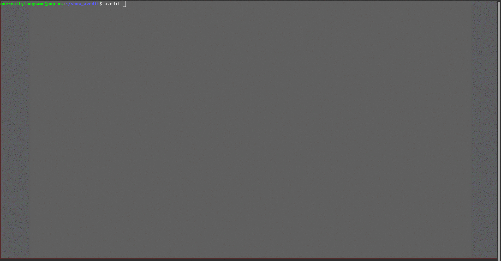

```
   █████████                         ██████████     █████  ███  ███████████             ███
  ███▒▒▒▒▒███                       ▒▒███▒▒▒▒▒█    ▒▒███  ▒▒▒  ▒█▒▒▒███▒▒▒█            ▒▒▒
 ▒███    ▒███  █████ █████ ████████  ▒███  █ ▒   ███████  ████ ▒   ▒███  ▒  █████ ████ ████
 ▒███████████ ▒▒███ ▒▒███ ▒▒███▒▒███ ▒██████    ███▒▒███ ▒▒███     ▒███    ▒▒███ ▒███ ▒▒███
 ▒███▒▒▒▒▒███  ▒███  ▒███  ▒███ ▒▒▒  ▒███▒▒█   ▒███ ▒███  ▒███     ▒███     ▒███ ▒███  ▒███
 ▒███    ▒███  ▒▒███ ███   ▒███      ▒███ ▒   █▒███ ▒███  ▒███     ▒███     ▒███ ▒███  ▒███
 █████   █████  ▒▒█████    █████     ██████████▒▒████████ █████    █████    ▒▒████████ ████
▒▒▒▒▒   ▒▒▒▒▒    ▒▒▒▒▒    ▒▒▒▒▒     ▒▒▒▒▒▒▒▒▒▒  ▒▒▒▒▒▒▒▒ ▒▒▒▒▒    ▒▒▒▒▒      ▒▒▒▒▒▒▒▒ ▒▒▒▒▒
```

| [Features](#features) | [Installation](#installation) | [Usage](#usage) | [Configuration](#configuration) | [Themes](#themes) | [For developers](#for-developers) |

# avredit

A terminal-based Avro schema editor inspired by lazygit. Navigate, edit, and manage `.avsc` schemas entirely from your terminal with vim-like keybindings, undo/redo, and live theme switching.
A port from [avro editor](https://github.com/onereallylongname/avro-editor-static-web), a static html site to render and edit avro schemas.



## Features

Working with Avro schemas in a text editor means juggling deeply nested JSON, remembering type syntax, and manually tracking named type references. avredit gives you:

- **Visual tree** of your schema structure — instantly understand nesting and types
- **Safe editing** — undo/redo everything, type pickers prevent typos
- **Named type awareness** — rename a record and all references update automatically
- **Zero setup** — single binary, no runtime dependencies
- [**Tree navigation**](#tree-normal-mode) — expand, collapse, and browse complex schemas with depth indicators
- **Inline editing** — edit field names, types, docs, defaults, and custom attributes
- **Structural mutations** — add, delete, copy, move fields; replace types
- **Named type propagation** — renaming a type updates all references across the schema
- **Undo/Redo** — full history stack (500 levels deep) with descriptions
- [**Search**](#search-prefixes) — prefix filters (`n:`, `t:`, `p:`, `ns:`, `a:`, `d:`) and fuzzy text matching (including doc fields)
- [**File Explorer**](#explorer-normal-mode) — browse, filter, and open `.avsc` files with recursive search
- [**Commands**](#command-mode) — vim-style `:w`, `:q`, `:wq`, `:export`, `:theme`, `:notifications`
- [**Diagnostics**](#diagnostics) — `:problems` / `:diagnostics` shows validation errors in a navigable picker
- [**Logging**](#logging) — structured logging with rotation, configurable level (CLI flag or runtime `:log-level`)
- [**Themes**](#themes) — JSON-based themes with runtime switching (ships with 10 themes)
- [**Symbols**](#symbols) — all UI icons are theme-configurable (expanders, cursors, status icons)
- **Categorized type picker** — types grouped by Primitives / Complex / Named / Aliases
- **Notifications** — colored flash messages with scrollable history log
- **Persistent history** — command and search history saved across sessions
- [**Config**](#configuration) — user preferences loaded from `~/.config/avredit/config.json`
- Diagnostics - `:problems` or `:diagnostics` to list all the validation warning and errors

## Installation

### From source

```bash
go install github.com/onereallylongname/avredit/cmd/avredit@latest
```

_**Note**: Add the go installation path to you $PATH_

## Usage

```bash
avredit <schema.avsc>
avredit <directory>
avredit                  # opens explorer in CWD
avredit --log-level debug ./schemas/
avredit --registry-url <url> --token <token>   # connect to a Schema Registry
avredit --help
avredit --version
```

### Quick Start

```bash
# Open a schema file directly
avredit schema.avsc

# Browse a directory of schemas
avredit ./schemas/

# Open in current directory
avredit
```

Once inside:

1. Use `j`/`k` to navigate the tree, `h`/`l` to collapse/expand
2. Press `Enter` to open the details panel for the selected node
3. Press `e` or `Enter` on an attribute to edit it
4. Press `a` to add a new field, `d` to delete
5. Use `u` to undo, `Ctrl+R` to redo
6. Type `:w` to save, `:q` to quit

## Keybindings

### Global

| Key         | Action               |
| ----------- | -------------------- |
| `q`         | Quit                 |
| `?`         | Show help overlay    |
| `Tab`       | Switch panel focus   |
| `1`/`2`/`3` | Focus panel directly |
| `Ctrl+E`    | Toggle file explorer |
| `Ctrl+G`    | Switch explorer between Files and Schema Registry |
| `Esc`       | Cancel / exit mode   |
| `Ctrl+S`    | Save                 |

### Tree (Normal Mode)

| Key      | Action               |
| -------- | -------------------- |
| `j`/`k`  | Navigate up/down     |
| `h`/`l`  | Collapse/expand node |
| `g`/`G`  | Jump to top/bottom   |
| `Space`  | Toggle expand        |
| `Enter`  | Focus details pane   |
| `a`      | Add field            |
| `d`      | Delete node          |
| `c`      | Copy node            |
| `m`      | Move to record       |
| `yy`     | Yank (copy) field name |
| `u`      | Undo                 |
| `Ctrl+R` | Redo                 |
| `/`      | Search               |

### Explorer (Normal Mode)

| Key             | Action                   |
| --------------- | ------------------------ |
| `j`/`k`         | Navigate up/down         |
| `h`/`l`         | Collapse/expand dir      |
| `Enter`/`Space` | Open file / toggle dir   |
| `g`/`G`         | Jump to top/bottom       |
| `Backspace`/`-` | Navigate to parent dir   |
| `.`             | Set selected dir as root |
| `/`             | Search files (recursive) |

### Details (Normal Mode)

| Key         | Action                 |
| ----------- | ---------------------- |
| `j`/`k`     | Navigate attributes    |
| `Enter`/`e` | Edit attribute         |
| `a`         | Add custom attribute   |
| `d`         | Delete attribute       |
| `R`         | Rename custom attr key |
| `yp`        | Yank (copy) attribute name |
| `yy`        | Yank (copy) attribute value |
| `ya`        | Yank (copy) "name: value"  |

### Edit Mode

| Key                      | Action                     |
| ------------------------ | -------------------------- |
| `Enter`                  | Confirm edit               |
| `Esc`                    | Cancel edit                |
| `Shift+Enter`            | Newline (multiline fields) |
| `Ctrl+V` / `Shift+Insert`| Paste from clipboard       |

### Search Mode

| Key                       | Action          |
| ------------------------- | --------------- |
| `/`                       | Open search     |
| `Enter`                   | Jump to match   |
| `n`/`N`                   | Next/prev match |
| `Esc`                     | Close search    |
| `Ctrl+V` / `Shift+Insert` | Paste from clipboard |

### Search Prefixes

| Prefix | Filters by             | Example          |
| ------ | ---------------------- | ---------------- |
| `n:`   | Field/record name      | `n:order`        |
| `t:`   | Type                   | `t:record`       |
| `p:`   | Parent name            | `p:Customer`     |
| `ns:`  | Namespace              | `ns:com.payment` |
| `a:`   | Alias                  | `a:OrderEvent`   |
| `d:`   | Doc text               | `d:deprecated`   |
| (none) | Free text (all fields, including doc) | `timestamp` |

### Command Mode

| Command            | Action                           |
| ------------------ | -------------------------------- |
| `:w [file]`        | Save (optionally to file)        |
| `:q`               | Quit                             |
| `:q!`              | Force quit (no save prompt)      |
| `:wq`              | Save and quit                    |
| `:export [file]`   | Export .avsc                     |
| `:theme [name]`    | Switch theme (picker if no name) |
| `:open <file>`     | Open schema file                 |
| `:validate`        | Run schema validation            |
| `:problems`        | Show diagnostics picker          |
| `:diagnostics`     | Alias for `:problems`            |
| `:log-level [lvl]` | Set log level (picker if no arg) |
| `:notifications`   | Show notification history        |
| `:registry check [subject]` | Compatibility check against the registry (see below) |
| `:registry report` | Reopen the last compatibility check report |

### Clipboard (Yank & Paste)

avredit uses vim-style yank keybindings to copy data to the system clipboard,
and supports pasting into any text input:

| Key                       | Where         | Action                                |
| ------------------------- | -------------- | -------------------------------------- |
| `yy`                      | Tree pane      | Yank the selected field/record's name   |
| `yp`                      | Details pane   | Yank the current attribute's name       |
| `yy`                      | Details pane   | Yank the current attribute's value      |
| `ya`                      | Details pane   | Yank `"name: value"`                    |
| `Ctrl+V` / `Shift+Insert` | Any text input | Paste from clipboard                    |

Yanks write to the clipboard two ways at once — OSC52 (via the terminal
itself, works over SSH with no extra tools) and a native tool (`pbcopy`,
`xclip`/`xsel`/`wl-copy`, or `clip`) — so whichever one your terminal/session
supports will land. Pastes first try the terminal's bracketed-paste (no
tools needed); `Ctrl+V`/`Shift+Insert` fall back to reading the native
clipboard directly for terminals that don't deliver bracketed-paste.

## Schema Registry

avredit can browse and fetch schemas from a **Confluent Cloud** Schema
Registry (or a self-hosted, Confluent-API-compatible registry). Support is
targeted specifically at the Confluent Schema Registry REST API; other
vendors (Apicurio, AWS Glue, etc.) are not tested and may not work.

**This is read-only.** avredit can list subjects, fetch schema versions, and
run compatibility checks, but it never registers/pushes schemas to the
registry — fetched schemas load into the editor buffer like any opened
file, and you save them to disk yourself with `:w <path>`.

### Connecting

Credentials are **session-only**: they're read once from CLI flags at
startup and never written to disk or config. Only the registry URL itself
is persisted (in `config.json`), never a token or password.

```bash
# Bearer token (e.g. Confluent Cloud API key/secret, or another Bearer-style token)
avredit --registry-url https://psrc-xxxxx.region.aws.confluent.cloud --token <token>

# Basic auth (username/password, e.g. Confluent Cloud API key as username + secret as password)
avredit --registry-url https://psrc-xxxxx.region.aws.confluent.cloud --user <key> --password <secret>
```

mTLS client-certificate auth is not supported.

### Browsing

Press `Ctrl+G` to switch the explorer panel from **Files** to **Registry**
mode (and back). The panel behaves just like the file explorer: subjects
are shown as expandable tree nodes (`j`/`k`/`h`/`l`/`enter`/`space`), `/`
searches the currently-fetched subjects, and pressing `enter` on a version
fetches that schema into the editor.

### Compatibility checking

`:registry check [subject]` checks the currently-open schema for
compatibility against a subject's latest registered version. If no subject
is given, avredit infers one from the loaded schema's `namespace`/`name`
using Confluent's default `TopicNameStrategy` (`<namespace>.<name>-value`).

If the schema **is compatible**, this is just a quiet one-line confirmation
in the status bar. If it's **not compatible**, a report opens automatically
showing which top-level fields were **added or removed**, with the
registry's own detailed per-field failure explanation (fetched via
`?verbose=true`) shown directly under whichever change it explains —
anything the registry reports that isn't tied to a specific field appears
under "Other reasons" instead of being dropped. Long lines wrap to fit the
terminal, and the registry's own context/config messages (echoed schema
version, compatibility mode, etc.) are filtered out — only actual failure
explanations are shown. Only the most recent check is kept — a new check
replaces it. Reopen it anytime with `:registry report`, and from the report
press `s` to save it to disk as a timestamped Markdown file (so repeated
checks never overwrite an earlier saved report).

## Tips & Tricks

- **Named type references** — When you change a record/enum/fixed name, all fields referencing that type update automatically
- **Type picker** — Press `/` inside the picker to filter by typing (case-insensitive)
- **Multiline editing** — For `doc` fields, press `Ctrl+Enter` to add newlines
- **Explorer search** — `/` in the explorer searches recursively through all subdirectories
- **History** — Use `↑`/`↓` in search (`/`) and command (`:`) modes to browse previous entries
- **Unsaved changes** — avredit prompts before quitting if you have unsaved edits
- **Persistent config** — Theme choice is saved to `~/.config/avredit/config.json` automatically
- **Multiple theme dirs** — Set `themes_dir` in config to load additional themes alongside built-ins
- **Diagnostics** — Use the command `:diagnostics` to list diagnostics, press enter on any to focus on the field at fault

## Diagnostics

avredit performs advisory validation on every schema mutation:

- **`:validate`** — manually trigger validation, shows error/warning summary
- **`:problems`** / **`:diagnostics`** — opens a navigable picker listing all issues
  - Errors (✗) sort first, then warnings (⚠)
  - Each item shows the affected node's name and path
  - Selecting an issue jumps to that node in the tree
- Validation is **advisory only** — it never blocks operations

### Validation rules

| Category   | Checks                                   |
| ---------- | ---------------------------------------- |
| Naming     | Duplicate field names within a record    |
| Types      | Duplicate branches in a union            |
| Required   | Missing required fields (`name`, `type`) |
| References | Named type reference validity            |

## Logging

avredit writes structured logs to `~/.config/avredit/log/avredit.log`:

- **Rotation**: 10 MB max file size
- **Format**: JSON-structured slog output with timestamps
- **Level**: Controlled via config (`log_level`) or CLI (`--log-level`)

```bash
# Run with debug logging
avredit --log-level debug schema.avsc

# Change level at runtime
:log-level         # opens picker (debug/info/warn/error)
:log-level debug   # set directly
```

All internal errors (save/open/edit/delete/copy/move failures) are logged with structured context (file paths, node IDs, error details) for easy debugging.

## Configuration

avredit reads configuration from `~/.config/avredit/config.json`:

```json
{
  "theme": "catppuccin-mocha",
  "themes_dir": "",
  "log_level": "error"
}
```

| Field        | Description                                            | Default   |
| ------------ | ------------------------------------------------------ | --------- |
| `theme`      | Default theme to load on startup                       | `"dark"`  |
| `themes_dir` | Custom directory for additional theme files (optional) | `""`      |
| `log_level`  | Log verbosity: `debug`, `info`, `warn`, `error`        | `"error"` |

### Theme discovery order

1. `./themes/` (current working directory)
2. Next to the `avredit` executable
3. `~/.config/avredit/themes/`

## Themes

Themes are JSON files. avredit ships with: `dark`, `light`, `monokai`, `catppuccin-mocha`, `tokyo-night`, `rose-pine`, `dracula`, `gruvbox`, `one-dark-pro`, `vscode-light` at [themes/](https://github.com/onereallylongname/avredit/tree/main/themes).

Switch at runtime with `:theme` (opens picker) or `:theme <name>`.

### Theme file format

To add a custom theme just copy or create a theme as described below.
Create a `.json` file in your themes directory:

```json
{
  "name": "my-theme",
  "fg": "#c0caf5",
  "bg": "#1a1b26",
  "dim": "#787c99",
  "muted": "#414868",
  "primary": "#7aa2f7",
  "secondary": "#bb9af7",
  "success": "#9ece6a",
  "warning": "#e0af68",
  "error": "#f7768e",
  "badge_record": "#7aa2f7",
  "badge_field": "#9ece6a",
  "badge_enum": "#bb9af7",
  "badge_array": "#e0af68",
  "badge_map": "#73daca",
  "badge_union": "#ff9e64",
  "badge_fixed": "#2ac3de",
  "badge_named": "#bb9af7",
  "status_bg": "#16161e"
}
```

| Color          | Purpose                                  |
| -------------- | ---------------------------------------- |
| `fg`           | Primary text foreground                  |
| `bg`           | Main background                          |
| `dim`          | Subdued text (guides, primitives)        |
| `muted`        | Very subdued (borders, separators)       |
| `primary`      | Accent (focus, active items)             |
| `secondary`    | Secondary accent (headings, enums)       |
| `success`      | Positive indicators (fields, edit mode)  |
| `warning`      | Warning indicators (arrays, search mode) |
| `error`        | Error indicators (flash errors)          |
| `badge_record` | Record node type color                   |
| `badge_field`  | Field node type color                    |
| `badge_enum`   | Enum node type color                     |
| `badge_array`  | Array node type color                    |
| `badge_map`    | Map node type color                      |
| `badge_union`  | Union node type color                    |
| `badge_fixed`  | Fixed node type color                    |
| `badge_named`  | Named reference type color               |
| `status_bg`    | Status bar background                    |

> **Tip:** All colors are optional. Omitted values fall back to sensible defaults derived from the primary/secondary accent colors.

### Symbols

Themes can override all UI symbols. Add a `"symbols"` section (all fields optional — defaults used for omitted values):

```json
{
  "name": "my-theme",
  "fg": "#c0caf5",
  "symbols": {
    "expanded": "▼",
    "collapsed": "▶",
    "leaf": "·",
    "named_ref": "→",
    "cursor": "▸",
    "detail_expand": "▾",
    "error": "✗",
    "warning": "⚠",
    "success": "✓",
    "scroll_up": "▲",
    "scroll_down": "▼"
  }
}
```

| Symbol          | Default | Purpose                        |
| --------------- | ------- | ------------------------------ |
| `expanded`      | `▼`     | Tree node expanded marker      |
| `collapsed`     | `▶`     | Tree node collapsed marker     |
| `leaf`          | `·`     | Tree leaf node marker          |
| `named_ref`     | `→`     | Named type reference badge     |
| `cursor`        | `▸`     | Picker/detail selection cursor |
| `detail_expand` | `▾`     | Detail section expanded marker |
| `error`         | `✗`     | Error indicator                |
| `warning`       | `⚠`     | Warning indicator              |
| `success`       | `✓`     | Success indicator              |
| `scroll_up`     | `▲`     | Scroll up hint                 |
| `scroll_down`   | `▼`     | Scroll down hint               |

> **Example**: The gruvbox theme uses ASCII symbols (`v`, `>`, `x`, `!`) for terminal compatibility.

### Setup example

```bash
# Create config directory
mkdir -p ~/.config/avredit/themes

# Write config
cat > ~/.config/avredit/config.json << 'EOF'
{
  "theme": "rose-pine"
}
EOF

# Copy or create a custom theme
cat > ~/.config/avredit/themes/custom.json << 'EOF'
{
  "name": "custom",
  "fg": "#d4d4d4",
  "bg": "#1e1e1e",
  "dim": "#808080",
  "muted": "#404040",
  "primary": "#569cd6",
  "secondary": "#c586c0",
  "success": "#6a9955",
  "warning": "#d7ba7d",
  "error": "#f44747",
  "badge_record": "#569cd6",
  "badge_field": "#6a9955",
  "badge_enum": "#c586c0",
  "badge_array": "#d7ba7d",
  "badge_map": "#4ec9b0",
  "badge_union": "#ce9178",
  "badge_fixed": "#9cdcfe",
  "status_bg": "#252526"
  "symbols": {
    "expanded": "▼",
    "collapsed": "▶",
    "leaf": "·",
    "named_ref": "→",
    "cursor": "▸",
    "detail_expand": "▾",
    "error": "✗",
    "warning": "⚠",
    "success": "✓",
    "scroll_up": "▲",
    "scroll_down": "▼"
  }
}
EOF
```

## License

MIT

---

# For developers

## Architecture

```
cmd/avredit/main.go          Entry point + CLI flags
internal/
  config/                   User configuration + persistent history
  logging/                  Structured logging (slog + lumberjack rotation)
  model/                    Bubbletea TUI models (app, tree, details, explorer, picker)
  projection/               Core schema tree (nodes, build, emit, clone, stats)
  command/                  Undo/redo mutation commands (create, remove, move, copy, replace, rename)
  search/                   Query engine (prefix filters, fuzzy scoring)
  schema/                   Avro type system constants (kinds, slots, templates)
  io/                       File load/export + clipboard
  theme/                    Theme system (JSON loader, registry, defaults, symbols)
  validation/               Advisory schema validation (duplicate names, unions)
themes/                     Bundled theme JSON files
docs/                       Architecture docs + plan
```

## How It Works

avredit uses a **projection model** architecture:

```
.avsc → Parse → Projection (flat node map) → Render UI
                       ↑                          |
                   Commands ←───────── User input (keys)
                       |
                       v
               Projection → Emit → .avsc
```

- The schema is parsed into a flat map of nodes linked by parent/child IDs
- Every edit creates a reversible Command (with Do/Undo closures)
- Commands are pushed to a history stack enabling unlimited undo/redo
- Export reconstructs valid Avro JSON by walking the tree

This means:

- Edits never corrupt the schema structure
- Undo works perfectly for any operation (add, delete, move, rename, type change)
- Named type renames propagate automatically to all references

See [`docs/ARCHITECTURE.md`](docs/ARCHITECTURE.md) for detailed design documentation.

## TODO

- [ ] Packaging
  - [ ] Homebrew (macOS/Linux) `brew install onereallylongname/tap/avredit`
  - [ ] Scoop (Windows)

```powershell
scoop bucket add avredit https://github.com/onereallylongname/scoop-bucket
scoop install avredit
```

- [ ] Pre-built binaries
  - [ ] Download from [Releases](https://github.com/onereallylongname/avro-schema-viz/releases).
